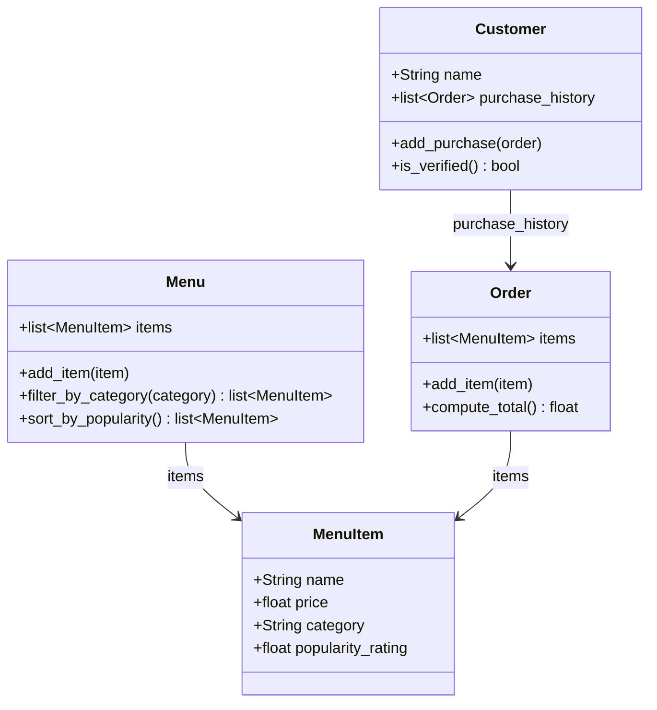

# ByteBites

Backend logic for **ByteBites**, a campus food ordering app. Plain Python classes keep track of customers, menu items, the menu, and orders. Everything lives in memory, and the code uses only the standard library.

This project was built for the CodePath AI 110 "tinker" activity. The client asked for a small, well-scoped design, so this is not a full application.

## Features

- **Menu items** with a name, price, category, and popularity rating.
- **Menu** that holds every item and can:
  - filter items by category (for example `"Drinks"` or `"Desserts"`)
  - sort items by popularity, highest rating first, without changing the menu itself
- **Orders** that group the selected items and compute the total cost, rounded to cents.
- **Customers** with a purchase history and a simple check that they are real users.

## Getting started

Requirements: Python 3. Install [pytest](https://docs.pytest.org/) if you want to run the tests.

```bash
git clone https://github.com/alexreifel/ai110-bytebites_tinker_activity.git
cd ai110-bytebites_tinker_activity
```

### Run the demo

```bash
python3 models.py
```

The demo walks through each feature, prints the results, and checks them with `assert` statements. It ends with `All checks passed.`:

```text
== 3. Filter by category ==
  Drinks:   ['Large Soda', 'Iced Tea']
  Desserts: ['Fudge Brownie']

== 4. Sort by popularity ==
  4.8  Fudge Brownie
  4.6  Spicy Burger
  ...
== 5. Build an order and compute the total ==
  Items: ['Spicy Burger', 'Large Soda', 'Fudge Brownie']
  Total: $14.73
```

### Run the tests

```bash
python3 -m pytest          # or just: pytest
python3 -m pytest test_bytebites.py::test_new_customer_is_not_verified   # one test
```

## Usage

```python
from models import MenuItem, Menu, Order, Customer

burger = MenuItem("Spicy Burger", 8.99, "Burgers", 4.6)
soda = MenuItem("Large Soda", 2.49, "Drinks", 4.1)

menu = Menu()
menu.add_item(burger)
menu.add_item(soda)

menu.filter_by_category("Drinks")   # [soda]
menu.sort_by_popularity()           # [burger, soda]; menu.items is unchanged

order = Order()
order.add_item(burger)
order.add_item(soda)
order.compute_total()               # 11.48

alex = Customer("Alex")
alex.is_verified()                  # False: no purchases yet
alex.add_purchase(order)
alex.is_verified()                  # True
```

## Design

There are four classes. They are linked by association ("has a") and none of them inherit from another. The approved class diagram is in [`bytebites_design.mmd`](bytebites_design.mmd):



| Class | Responsibility |
| --- | --- |
| `MenuItem` | Stores data only: name, price, category, popularity rating. |
| `Menu` | Holds all items. Filters by exact category match and returns a new list sorted by popularity. |
| `Order` | A single transaction (the spec's word). Stores the selected items and computes the total. |
| `Customer` | Has a name and a purchase history made of whole `Order` objects. |

### Design decisions

- **"Verify they are real users"** means `is_verified()` returns `True` once the customer has at least one past order. It is not authentication.
- **`purchase_history` stores whole `Order` objects**, not loose items, so each past transaction stays grouped.
- **One-way links.** `Order` does not point back to `Customer`.
- **`sort_by_popularity()`** was added at the client's request. It returns a new list so the menu's original order is kept.

### Out of scope

The spec deliberately leaves these out: authentication, a database, item IDs, quantities, tax or discounts, order status, and removing items.

## Project files

| File | Purpose |
| --- | --- |
| [`models.py`](models.py) | The four classes, plus a runnable demo. |
| [`test_bytebites.py`](test_bytebites.py) | Pytest behavior tests. |
| [`bytebites_spec.md`](bytebites_spec.md) | The client's feature request (what to build). |
| [`ByteBites_Design_Reference.md`](ByteBites_Design_Reference.md) | Project scope and build guidelines (how to build it). |
| [`bytebites_design.mmd`](bytebites_design.mmd) | The approved Mermaid class diagram. |
